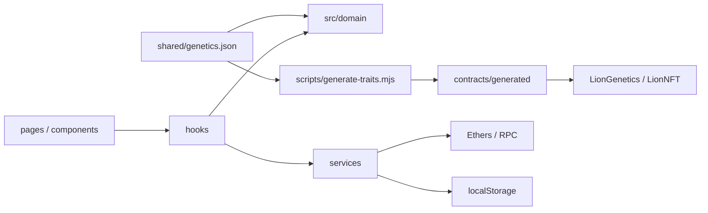

# 工程约定

所有改动限定在本目录。使用本项目 `.venv` 和本地 `node_modules`，不要激活外层 `quant` 环境，也不要引用量化项目代码。

## 模块职责



- `domain`：纯数据规则、遗传、图鉴统计、家谱遍历。不得读取浏览器存储、钱包或环境变量。时间、种子、仓库通过参数传入。
- `services`：存储校验与迁移、Ethers 数据归一化、RPC、交易生命周期。Ethers `Result` 不得流入 UI。
- `hooks`：请求取消、账号与页面状态、交易串行控制。过期响应不能覆盖新账号、新家谱的结果。
- `pages/components`：展示及用户输入。概率不能在 JSX 中重新计算；调用 domain 的预览函数。应用壳只负责导航和组合页面。
- `contracts/LionGenetics.sol`：纯遗传算法；`LionNFT.sol`：ERC-721、权限、冷却、基因与亲缘索引；`LionArt.sol`：链上 SVG。
- `src/generated/LionNFT.abi.json` 来自编译产物，不手写 ABI。`contracts/generated` 只能通过生成脚本更新。

当前控制器约 340 行、应用壳约 550 行，均已从原先单体页面中拆出；新增独立玩法应增加自己的页面、hook 和 domain 模块，不能继续向控制器堆积算法。

## 编写与注释

- 使用 ESLint 检查未使用标识符、严格比较与 React Hook 依赖；Prettier 统一 JS、JSX、CSS、JSON、Markdown 和 Solidity 格式。不要通过关闭规则掩盖问题。
- Solidity 对外接口使用 NatSpec，说明用途及影响安全或资产语义的约束。复杂 JS 公共数据结构用 JSDoc，参考 `src/domain/types.js`。
- 注释解释约束与原因，例如为什么采用独立随机域、为什么不能在交易确认后报告铸造失败；不逐行翻译代码。
- ID 使用安全整数；DNA 始终为十进制字符串或 `bigint`。时间戳统一为秒，只有 UI 时钟使用毫秒。
- 输入先校验，禁止静默写入坏数据。迁移保留旧快照，不伪造历史血缘或隐性基因。
- 家谱每次只加载两级祖辈，点击节点继续追溯；子代分页，不能无界递归或扫描全链。个人图鉴使用同一区块快照分批读取完整收藏。
- 生成的文件、格式化变化、业务修改应便于分别审查。新增库必须服务于明确需求；无须引入状态管理框架来包装已有局部状态。

## 本地检查

```bash
source .venv/bin/activate
npm ci
npm run generate:traits   # 仅在修改概率配置时需要
npm run format
npm run check
```

`check` 包含生成配置一致性、lint、格式检查、纯逻辑测试、Solidity 编译/ABI 同步、合约测试及前端生产构建。业务改动需补充对应行为测试；不要为纯排版添加模拟实现的测试。

浏览器回归：

```bash
npx playwright install chromium
npm run test:ui
```

当前 WSL 缺失的浏览器依赖已经解包在 `.venv/browser-libs`，可使用：

```bash
LD_LIBRARY_PATH="$PWD/.venv/browser-libs/usr/lib/x86_64-linux-gnu${LD_LIBRARY_PATH:+:$LD_LIBRARY_PATH}" npm run test:ui
```

链上浏览器测试使用本地节点和刚部署的空合约：`npm run chain`、`npm run deploy:local`，然后 `LION_CHAIN_TEST=1 npm run test:ui`。它测试真实 EVM 交易，但不替代 MetaMask 和 Sepolia 的部署后验证。

## 修改文案与外观

SVG 外观放在 `LionPortrait.jsx`，链上简化图放在 `LionArt.sol`。稀有结构不能只依赖图片服务器。新增中文文案后，可运行 `python scripts/update-fonts.py` 更新随项目提供的字体子集；这是可选维护操作，运行和构建无需联网下载字体。

字体授权位于 `public/fonts`。本项目的 `.env.local`、私钥、缓存、截图测试结果和依赖目录均不得提交。
