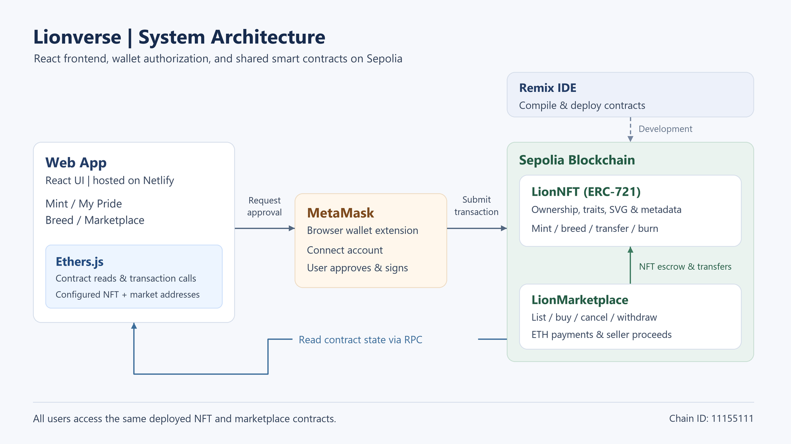

# Lionverse NFT DApp

Lionverse is a COMP7610 coursework application for minting, collecting, breeding, transferring, trading and burning lion NFTs. Ownership, traits, ancestry, listings and seller proceeds are recorded in Solidity smart contracts on Sepolia.

**[Open the live DApp](https://symphonious-sherbet-47ba97.netlify.app/)** · **[Deployment and transaction evidence](docs/Deployment-Sepolia.md)** · **[Detailed Remix guide](remix/README.md)**

The primary deployment workflow is **Remix + MetaMask + Sepolia**. Hardhat is used for automated tests and optional local development. The website communicates with the contracts through Ethers.js; Remix does not need to remain open after deployment.

## 1. Use the live application

No installation, source download or contract deployment is needed to use the hosted website.

1. Open the [live DApp](https://symphonious-sherbet-47ba97.netlify.app/) in a browser with MetaMask installed.
2. Unlock your own wallet and select **Sepolia**, chain ID **11155111**. Enable test networks in your wallet if Sepolia is hidden.
3. Have some **Sepolia test ETH** for network gas and, if purchasing, the displayed sale price.
4. Click **Connect Wallet** and approve the connection in MetaMask.
5. Use **Mint**, **My Pride**, **Breed** or **Marketplace**. Approve each state-changing transaction and wait for confirmation.

To interact with a teammate, both users open the same URL with their own wallet accounts on Sepolia. They use the shared contracts below. A second computer does not need its own deployment or access to the first computer's local server.

### Current Sepolia deployment

| Contract        | Address                                                                                                                         |
| --------------- | ------------------------------------------------------------------------------------------------------------------------------- |
| LionNFT         | [`0x853E3613Be4d66D656bE481A377c314bfe40e97e`](https://sepolia.etherscan.io/address/0x853E3613Be4d66D656bE481A377c314bfe40e97e) |
| LionMarketplace | [`0x2af1853622a2FDcEdA675850D4a8385591718154`](https://sepolia.etherscan.io/address/0x2af1853622a2FDcEdA675850D4a8385591718154) |

Confirmed deployment and operation receipts are linked in [the deployment record](docs/Deployment-Sepolia.md).

## 2. Features and rules

| Feature      | Behaviour                                                                            |
| ------------ | ------------------------------------------------------------------------------------ |
| Mint         | Create a founder NFT. There is no application mint fee; network gas still applies.   |
| My Pride     | View owned NFTs, artwork, traits, generation and ancestry.                           |
| Breed        | Create a child from two different, owned lions whose cooldowns have finished.        |
| Transfer     | Send an owned NFT to another wallet; the recipient connects that account to view it. |
| List and buy | Sell an NFT at a fixed ETH price through marketplace escrow.                         |
| Cancel       | The seller cancels an active listing and receives the NFT back.                      |
| Withdraw     | The seller separately withdraws proceeds credited by successful purchases.           |
| Burn         | The current owner permanently destroys an NFT after an exact-token-ID confirmation.  |

### Traits and breeding

Each lion has four visible traits: **species, fur, mane and eyes**. It also stores generation, creation time and two parent IDs. Founder species probabilities are:

- **60% Classic:** Savanna, Snow, Golden and Diamond combined.
- **30% Monochrome:** a black-and-white gradient appearance.
- **10% Rainbow:** a rainbow gradient appearance.

Within the Classic group, the relative species weights are 6200 / 2400 / 900 / 350. Fur has six values, mane three and eyes four. There are **432 encoded combinations**; rendering rules can make some look similar. Matching artwork does not make two token IDs the same NFT.

For breeding, each trait independently inherits either parent's value with a 50% chance. There are no hidden genes or mutations. The child's generation is `max(parent generations) + 1`. Newly created lions and parents used in breeding have a **five-minute cooldown**. Founder probabilities do not apply to inherited offspring.

The lifetime supply limit is **10,000 births**, including offspring and burned NFTs. Probabilities do not guarantee exact proportions in a small sample.

### Trading and burning

Listing normally requires **two wallet transactions**: approval of that NFT, followed by listing. Once listed, the NFT belongs to marketplace escrow and leaves the seller's wallet collection. It cannot breed or be burned by the seller while listed.

Buyers pay the exact listed ETH price plus gas. The NFT transfer and seller credit happen atomically. Sellers use **Withdraw Proceeds** to receive credited ETH. There is no platform fee or royalty deduction, and sellers cannot buy their own listings.

Only the current owner can burn an NFT; approval alone does not grant burn permission. Burning provides no refund and cannot be undone. IDs are never reused, and burning does not restore minting capacity. `totalSupply()` counts active NFTs; `totalMinted()` counts lifetime births.

On-chain traits, ancestry and SVG artwork remain readable through `getLion()` and `historicalTokenURI()` after burning. Standard `ownerOf()` and `tokenURI()` reject burned IDs. Background stories are frontend content rather than additional on-chain metadata.

## 3. Architecture



- **React + Vite:** the four-page web interface, hosted on Netlify for the live demo.
- **Ethers.js:** contract reads through RPC and transaction calls through the wallet.
- **MetaMask:** account selection, network switching and user-approved signing.
- **LionNFT:** ERC-721 ownership, enumeration, minting, breeding, burning and metadata.
- **LionTraits / LionArt:** trait selection and inheritance, plus on-chain SVG rendering.
- **LionMarketplace:** listings, escrow, purchases, cancellations and withdrawals.
- **Remix:** compilation and Sepolia deployment, independent of runtime access.

There is no application database. Users share state by using the same chain and contract addresses.

## 4. Run the source against the existing Sepolia contracts

### Requirements

- **Node.js 24 LTS** with npm. Node.js 22.12 or newer in the 22.x line is also supported by the toolchain.
- Git to clone the repository.
- Internet access to the configured Sepolia RPC.
- A browser with MetaMask for transactions.

Python is not required to run, compile or test the DApp. The optional font-maintenance script is separate from the normal workflow.

### Clone and install

Examples use **Windows PowerShell** from the repository root.

The repository's `.gitattributes` keeps text files in LF format on Windows as well as other systems. Prettier uses the same setting, so a fresh clone can run the checks without changing Git's global configuration. If an existing checkout reports line-ending errors, run `npm run format`, then `npm run check`.

```powershell
git clone https://github.com/PYLunar/lionverse-dapp.git
cd lionverse-dapp
npm ci
```

### Configure the public deployment

```powershell
$nftAddress = "0x853E3613Be4d66D656bE481A377c314bfe40e97e"
$marketAddress = "0x2af1853622a2FDcEdA675850D4a8385591718154"
npm run remix:connect -- --nft $nftAddress --market $marketAddress
npm run dev -- --host 127.0.0.1 --port 5173 --strictPort
```

Open **http://127.0.0.1:5173/** and connect MetaMask on Sepolia. Stop the server with `Ctrl+C` when finished. This local frontend reads the same collection and market as the hosted site.

`remix:connect` checks the network, deployed code, NFT settings and the market's NFT binding. It writes `.env.local` and a connection record under `deployments/`. It does not deploy contracts or sign transactions.

For another Sepolia RPC:

```powershell
npm run remix:connect -- --nft $nftAddress --market $marketAddress --rpc https://YOUR_SEPOLIA_RPC
```

### Environment settings

The validated connection command creates these settings automatically. `.env.example` documents the same fields for manual configuration:

```dotenv
VITE_CONTRACT_ADDRESS=0x853E3613Be4d66D656bE481A377c314bfe40e97e
VITE_MARKET_ADDRESS=0x2af1853622a2FDcEdA675850D4a8385591718154
VITE_CHAIN_ID=11155111
VITE_RPC_URL=https://ethereum-sepolia-rpc.publicnode.com
```

These are public frontend settings. `VITE_` values are included in the browser build; do not place private keys, seed phrases or private API credentials in them. MetaMask handles signing. Restart Vite after changing configuration, and rebuild before publishing a changed configuration.

## 5. Deploy a new pair using Remix

Use this workflow for a separate collection or a changed contract implementation. Existing users can use the public deployment without doing this.

1. Open [Remix IDE](https://app.remix.live/) with MetaMask and create a dedicated workspace.
2. Import `remix/Lionverse.sol`. This self-contained file includes the project contracts and pinned OpenZeppelin 5.4.0 dependencies. No remote Solidity imports or separate library deployments are required.
3. Copy `remix/remix.config.json` into the workspace configuration. Select Solidity **0.8.28+commit.7893614a** and **Use configuration file**. Confirm optimizer **200 runs**, **viaIR enabled** and EVM target **Paris** in Compilation Details. Older Remix versions can use `remix/compiler_config.json`.
4. Compile `Lionverse.sol`. Choose **LionNFT** in Deploy & Run.
5. Select **Browser Extension / MetaMask** on Sepolia, keep transaction value at zero, deploy LionNFT and approve in MetaMask. Its constructor takes no arguments.
6. Choose **LionMarketplace**, pass the NFT address as `collection`, and deploy it through MetaMask.
7. Read the marketplace's `nft()` value and confirm that it matches the NFT address. Save both addresses and deployment receipts.
8. Run `npm run remix:connect -- --nft YOUR_NFT_ADDRESS --market YOUR_MARKET_ADDRESS`, then start the frontend or rebuild the hosted version.

See the [detailed Remix guide](remix/README.md) and the [deployment checklist](docs/Remix-Deployment-Guide.md) for configuration details.

After contract changes, run `npm run compile` to synchronize frontend ABIs, then `npm run remix:prepare` to rebuild and validate the portable source. Do not edit generated `remix/Lionverse.sol` directly. Preparation checks compilation, runtime size, library linking, settings and ABI compatibility.

Remix VM is an isolated browser chain, not Sepolia. A new non-upgradeable contract does not modify an old deployment. Changing addresses does not migrate NFTs, listings or seller proceeds; access those through their original contracts.

## 6. Optional local blockchain development

This creates an independent collection on chain ID **31337** and does not interact with the Sepolia NFTs.

In terminal 1, keep the chain running:

```powershell
npm run chain
```

In terminal 2, deploy both contracts and start the frontend:

```powershell
npm run deploy:local
npm run dev -- --host 127.0.0.1 --port 5173 --strictPort
```

Deployment updates `.env.local` for RPC `http://127.0.0.1:8545` and saves local records under `deployments/`. In MetaMask, use the local network and one of the public development accounts printed by Hardhat. Those accounts are for disposable local testing only.

Restarting the local chain clears its state. Deploy again after a reset. To return to Sepolia, stop Vite, run the Sepolia connection command in Section 4 and restart Vite.

`npm run deploy:market:local` can add a marketplace to an already configured local NFT contract. It does not migrate listings or proceeds from an older marketplace.

## 7. Tests and validation

```powershell
npm run check
```

This runs ESLint, Prettier checks, compilation, the contract suite and a production build. The current suite has **18 tests**: nine NFT tests, eight marketplace tests and one Remix connection-validation test. It covers probabilities, inheritance, ownership, cooldowns, metadata, burn history, approval, escrow, payment, cancellation, withdrawal and failure handling.

### Browser checks

```powershell
npx playwright install chromium
npm run test:ui
```

The default run checks the English interface and wallet-required states. The full local-chain scenario is skipped unless enabled. Playwright starts Vite on port **5174**, which must be free.

For the full scenario, use a **disposable local chain and a freshly deployed empty NFT/market pair**. The test changes state, advances local EVM time and burns NFTs. With the local chain running, run:

```powershell
npm run deploy:local
$env:LION_CHAIN_TEST = "1"
try {
    npm run test:ui
} finally {
    Remove-Item Env:LION_CHAIN_TEST -ErrorAction SilentlyContinue
}
```

`LION_TEST_RPC_URL` defaults to `http://127.0.0.1:8545` and must match the local frontend configuration. The scenario uses a test-only adapter for unlocked local accounts. It exercises minting, wallet rejection, breeding, transfer, account switching, listings, purchases, withdrawals, cancellation and burning. It is not a real MetaMask/Sepolia test. Restore the Sepolia configuration after local testing if needed.

### Manual two-account Sepolia demonstration

1. Connect A; mint two lions and inspect their traits.
2. Wait for both cooldowns; breed and inspect the child's generation and parents.
3. Transfer a lion to B; connect B and verify it in **My Pride**.
4. With A, approve and list another lion; with B, locate it in **Marketplace** and purchase it.
5. Confirm B owns the NFT; return to A and choose **Withdraw Proceeds**.
6. List and cancel a separate NFT; verify it returns to the seller.
7. Burn an unwanted, unlisted NFT last, using its exact ID; verify the receipt and updated collection.

Save token IDs, account identities, prices and transaction links. The completed demonstration uses different tokens for different cases; the evidence register records the actual IDs and receipts.

The report screenshots and edited video come from separate test sessions: the report documents mint #12 and breeding #1 + #2 into #13, while the video shows mint #9 and breeding #7 + #8 into #11. See the [evidence mapping](docs/Deployment-Sepolia.md#report-and-video-evidence-mapping) for the shared cases.

## 8. Production build and hosting

Configure Sepolia as in Section 4 before building:

```powershell
npm run build
npm run preview -- --host 127.0.0.1
```

Open the preview address printed in the terminal. The output is **`dist/`**. For manual Netlify deployment, upload its contents so that `index.html` is at the deployment root. For a repository-connected Netlify build, use build command `npm run build`, publish directory `dist`, and set the four public `VITE_` variables in the site's build environment.

Verify the deployed URL is publicly accessible. Publishing the frontend does not reset or redeploy contracts. A configuration change requires a new build and deployment; it does not change an already published bundle automatically.

## 9. Repository structure

```text
contracts/             NFT, trait, artwork and marketplace Solidity source
contracts/test/        Test harnesses and receiver/withdrawal actors
src/                   React UI, domain labels and Ethers.js integration
src/generated/         Checked-in frontend contract ABIs
remix/                 Portable source, compiler configs and dependency license
scripts/               Deployment, connection validation and ABI/bundle tools
test/                  Local contract and connection-validation tests
tests/ui/              Playwright interface and optional local-chain tests
docs/                  Architecture, Sepolia receipts and deployment guides
public/fonts/          Bundled fonts and license notices
.env.example           Public frontend configuration template
```

### Useful commands

| Command                           | Purpose                                             |
| --------------------------------- | --------------------------------------------------- |
| `npm run dev`                     | Start the Vite development server.                  |
| `npm run build`                   | Build production assets into `dist/`.               |
| `npm run preview`                 | Serve the existing build locally.                   |
| `npm run compile`                 | Compile and synchronize frontend ABIs.              |
| `npm run remix:prepare`           | Regenerate and validate the portable Remix bundle.  |
| `npm run remix:connect -- --help` | Show Sepolia connection command syntax.             |
| `npm test`                        | Run 18 contract and connection-validation tests.    |
| `npm run test:ui`                 | Run browser checks; chain scenario requires opt-in. |
| `npm run check`                   | Run lint, formatting, contract tests and build.     |
| `npm run chain`                   | Start a local Hardhat blockchain.                   |
| `npm run deploy:local`            | Deploy and configure a new local NFT/market pair.   |

## 10. Troubleshooting

| Symptom                                 | What to check                                                                                                    |
| --------------------------------------- | ---------------------------------------------------------------------------------------------------------------- |
| No wallet detected                      | Use a browser with MetaMask installed and enabled, then reload.                                                  |
| Collection or listings fail to load     | Check RPC, chain ID and both addresses. Run the validated connection command.                                    |
| Wrong network                           | Use Sepolia for the public deployment; chain 31337 is for local development.                                     |
| A teammate cannot see a listing         | Check the same addresses and network, wait for the listing receipt and refresh. Approval alone is not a listing. |
| A listed lion disappeared from My Pride | It is in marketplace escrow. Buy or cancel through Marketplace.                                                  |
| Breeding is unavailable                 | Own two different unlisted lions and wait for both cooldowns.                                                    |
| Seller has not received ETH             | Connect the seller and use Withdraw Proceeds; a sale initially credits the contract.                             |
| NFT absent from MetaMask's NFT tab      | Check My Pride first. Wallet display may require importing the NFT contract address and token ID.                |
| Port already in use                     | Stop the server using it or choose another development port. Browser tests require 5174.                         |
| Changed configuration has no effect     | Restart Vite, or rebuild and republish the static site.                                                          |
| Wallet request rejected                 | That request did not submit the operation. Recheck page state before retrying.                                   |
| PowerShell blocks npm.ps1               | Use `npm.cmd` instead of `npm` in the commands above.                                                            |

## 11. Scope and attribution

This is an educational testnet project. Block-based randomness is influenceable and unsuitable for paid random rewards. Minting is free apart from gas. On-chain SVG and metadata make assets self-contained but increase gas usage; fees vary.

The marketplace supports one collection and fixed ETH prices. Use **List for Sale** rather than directly transferring an NFT to the market address. Unsolicited safe transfers are rejected; an unsafe `transferFrom` can lock an unlisted NFT because no administrative rescue function exists.

**All frontend work was completed by AI.** Frontend development is excluded from the three student members' reported responsibilities. Their allocated areas cover NFT contract work and deployment, marketplace work and transaction verification, and testing, documentation and video coordination. Final member identities and responsibilities belong in the submitted report.

The edited demonstration uses AI-generated English male narration and subtitles. Waiting periods are shortened; the operation footage comes from recorded Sepolia tests.

OpenZeppelin and bundled fonts retain their license notices in `remix/OpenZeppelin-LICENSE` and `public/fonts/`. See [CONTRIBUTING.md](CONTRIBUTING.md) for development guidance. This source is the simplified coursework edition; older contracts and their assets remain separate from the Sepolia pair above.
